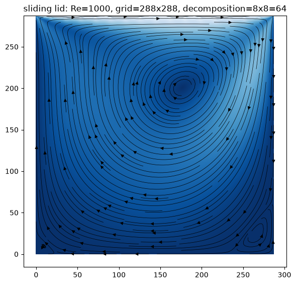

# Lattice Boltzmann D2Q9 Solver in Fortran

A configurable, coarray-parallel 2D lattice Boltzmann (D2Q9) fluid solver written in modern Fortran, validated on classic flow benchmarks and scaled on an HPC cluster (bwUniCluster).

Developed for the *High-Performance Computing: Fluid Mechanics with Fortran* course at the Albert-Ludwigs-Universität Freiburg, based on the lecture by Prof. Andreas Greiner.



## Highlights

- **Validated** against analytical solutions: shear-wave and density-wave decay, Couette flow, Poiseuille flow
- **Parallel** via Fortran coarrays (domain decomposition, runs on multi-node clusters)
- **Benchmarked**: MLUPS measurements up to 361 tasks on a 1536 × 1536 lattice (Re = 1000, lid-driven cavity)
- **Optimization study**: push vs. pull streaming, fused collide-stream kernels, and more (see `optim-*` branches)

<!-- TODO: add 1-2 concrete numbers, e.g. "Parallel efficiency of X% at 256 tasks", "Y MLUPS" -->

## Features

**Physics and configuration**
- Grid size, number of time steps and relaxation parameter ω are configurable
- External force: pressure gradient
- Initial conditions for velocity and density fields: constant, sine wave, Gaussian
- Boundary conditions configurable per wall: periodic or bounce-back
- Optional moving walls (e.g. Couette flow, lid-driven cavity)

**Output**
- Four loggers: `field`, `profile_x`, `profile_y`, `point`
- Configurable number of output frames
- Optional debug info for logger jobs


## Getting started
 
**Requirements**
- Intel oneAPI Fortran compiler (`ifx`) with coarray support (Intel MPI is needed for multi-node runs)
- GNU Make
**Build**
 
```bash
# Linux
make -f Makefile.linux
 
# Windows (run from an Intel oneAPI command prompt)
make -f Makefile.windows
```
 
The build creates `bin/lbm` (`bin\lbm.exe` on Windows) and the `out/` directory tree
used by the loggers (one subfolder per experiment: `swd`, `dwd`, `gwd`, `cf`, `pf`, `sl`, `mw`).
 
**Run**
 
The program takes the experiment name as its argument:
`shear-wave-decay`, `density-wave-decay`, `gaussian-wave-decay`, `couette-flow`,
`poiseuille-flow`, `sliding-lid` or `moving-walls`.
 
The number of coarray images is set through an Intel MPI launcher file, whose path is given in
the `FOR_COARRAY_CONFIG_FILE` environment variable. The scripts in `run/` create this file,
(re)build the program and run the experiments for you.
 
*Windows (all experiments, N images):*
 
```bat
run\all-tests.cmd 4
```
 
*Cluster (SLURM, bwUniCluster):* edit the `#SBATCH` header (partition, nodes, tasks per node) and submit
 
```bash
sbatch run/all-tests.sh
```
 
The cluster script loads `compiler/intel` and `mpi/impi`, compiles on the compute node (the binary is tuned
to the node's CPU) and runs the scaling series with 1, 4, 9, ..., 121 images (n = i², i = 1..11).
 
*Manual run (e.g. 4 images, `sliding-lid`):*
 
```bash
export FOR_COARRAY_CONFIG_FILE=./lbm.conf
echo "-genvall -genv I_MPI_FABRICS=shm:ofi -n 4 ./bin/lbm sliding-lid" > "$FOR_COARRAY_CONFIG_FILE"
./bin/lbm sliding-lid
```
 
Results are written to `out/<experiment>/`.
 
**Clean**
 
```bash
make clean
```
 
> **Note:** the code is compiled with `-O3 -xHost -ipo`, so the binary is tuned for the CPU it was built on.
> Rebuild it on the target machine (e.g. on the cluster) instead of copying it.

## Experiments

Ready-made configurations live in `config/`:

| Experiment | What it simulates | What it validates |
|---|---|---|
| `gaussian-wave-decay` | Gaussian density pulse in a box and in a tube | Acoustic wave propagation, boundary behavior |
| `density-wave-decay` | Decay of a sinusoidal density wave | Relation between ω and kinematic viscosity |
| `shear-wave-decay` | Decay of a sinusoidal shear wave | Viscosity measurement vs. theory |
| `couette-flow` | Flow between a moving and a fixed wall | Linear velocity profile |
| `poiseuille-flow` | Pressure-driven channel flow | Parabolic velocity profile |
| `sliding-lid` | Lid-driven cavity | Comparison with reference solutions |
| `moving-walls` | Further moving-wall setups | — |

Results and plots are in [`eval/results.ipynb`](eval/results.ipynb). Raw data is not included because of repository size limits.

## Performance study

Experiments were run on bwUniCluster. Two branch families document the work.

### Single-core optimization (`optim-*`)

All variants target the lid-driven cavity. Parameters are hard-coded and must be set before building.

| Branch | Idea |
|---|---|
| `optim-minimal` | Only the code required for the experiment; collision fused into a single subroutine |
| `optim-pull-streaming` | Pull instead of push streaming (sequential writes instead of reads) |
| `optim-fusion` | Streaming and collision fused into a single loop |
| `optim-spaghetti` | Collapse code into one routine to reduce call overhead |

Each run writes the final lattice state and statistics: number of tasks, image number, MLUPS, total time, and time spent in collision, streaming and <communication?>. IO time is excluded.

<!-- TODO: summarize the winner, e.g. "pull streaming gave X% speedup over push" -->

### Scaling (`scaling-*`)

Lid-driven cavity at Re = 1000.

| Branch | Hardware | Grid | Notes |
|---|---|---|---|
| `scaling-Re1000-L300` | Intel Ice Lake | 300 × 300 | |
| `scaling-Re1000-L1536` | Intel Ice Lake | 1536 × 1536 | |
| `scaling-Re1000-L1536-spread` | Intel Ice Lake | 1536 × 1536 | Max. 32 tasks per node |
| `scaling-Re1000-L1536-cpu` | 96-task CPUs | 1536 × 1536 | |

Evaluation graphs: [`eval/evaluation.ipynb`](eval/evaluation.ipynb).

> **Note:** in the heatmaps the Y axis is reversed: the top of the plot is SOUTH, the bottom is NORTH.

<!-- TODO: embed the key scaling plot (speedup / parallel efficiency vs. number of tasks) -->

## Repository structure

```
.
├── src/        Fortran sources
├── config/     Experiment configurations
├── eval/       Analysis notebook
├── .gitignore
├── Makefile.linux
├── Makefile.windows
└── README.md
```

<!-- TODO: adjust to your actual layout -->

## Branches

`master` holds the general solver. The `optim-*` and `scaling-*` branches are experiment snapshots and are not meant to be merged back.

## Acknowledgements

Course: *High-Performance Computing: Fluid Mechanics with Fortran*, Albert-Ludwigs-Universität Freiburg. Computations performed on bwUniCluster. The author acknowledges support by the state of Baden-Württemberg through bwHPC.

## License

This project is licensed under the [MIT License](LICENSE).